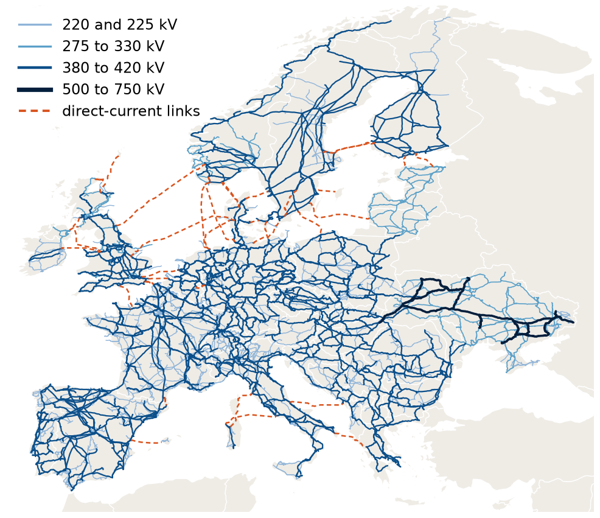

# electrical-networks

Power transmission networks as weighted graphs: a Python package, `gridnet`, and the scripts behind a series of posts on how such networks are reduced, where their power flow has solutions and where it loses them, and how they move after a disturbance. Every function implements a method from a publication and names it in its docstring, and every method is tested on a case with a known answer before it is run on a real network.



The series is published at <https://coding.wirbellinie.de>. The code is released in three parts, each together with its posts.

| Release | Posts | Modules of `gridnet` | |
|---|---|---|---|
| Aggregation | [Foundations I - Equations of Power Grids](https://coding.wirbellinie.de/foundations-i-equations-of-power-grids/); [Foundations II - Problems of Power Grids](https://coding.wirbellinie.de/foundations-ii-problems-of-power-grids/); [Aggregation I - Clusters as Nodes](https://coding.wirbellinie.de/aggregation-i-clusters-as-nodes/); [Aggregation II - Cuts of the European Grid](https://coding.wirbellinie.de/aggregation-ii-cuts-of-the-european-grid/); [Aggregation III - Sparse Reductions](https://coding.wirbellinie.de/aggregation-iii-sparse-reductions/) | `network`, `admittance`, `examples`, `pypsa_io`, `graph`, `powerflow`, `cycles`, `spectral`, `kron`, `rei`, `sparsify`, `reweight` | in this repository |
| Statics | Statics I - Power flow and its solutions; Statics II - The loading limit; Statics III - Linear flow and contingencies; Statics IV - Optimal power flow | `continuation`, `limits`, `security`, `opf`, `equilibria` | to come |
| Dynamics | Dynamics I - Transient stability; Dynamics II - Coherency; Dynamics III - Frequency and inertia; Dynamics IV - Cascades | `dynamics`, `machines`, `andes_io`, `coherency`, `frequency`, `cascade` | to come |

## Foundations

The first two posts set up the models. Their code is the base of everything else: the network as a data structure, read from MATPOWER case files (`network`) and from PyPSA networks and the PyPSA-Eur OpenStreetMap archive (`pypsa_io`); the bus admittance matrix and the linear flow model with transformers, shunts and phase shifters (`admittance`); incidence matrices, Laplacians, the pseudoinverse and effective resistances (`graph`); the Newton power flow (`powerflow`); and small networks with closed-form answers (`examples`).

The bus admittance matrix and the matrices of the linear flow model agree with MATPOWER's `makeYbus` and `makeBdc` through their PYPOWER ports, the bus types follow MATPOWER's `bustypes`, and the power flow agrees with PYPOWER's `runpf` on the MATPOWER cases and on the synthetic Texas grid.

## Aggregation

Three posts on replacing a network by a smaller one. The modules cover fundamental cycle bases and winding numbers (`cycles`); spectral partitioning with sweep cuts, Cheeger's bounds and the coarsening of Loukas (`spectral`); Kron reduction with its accompanying matrix (`kron`); REI equivalents (`rei`); spectral sparsification by sampling and by selection, and approximate Schur complements (`sparsify`); and the reweighting of a reduced network against a reference, spectrally or by its distribution factors (`reweight`).

The tests check the Kron reduction against the properties proved by Dörfler and Bullo (2013): the reduced matrix is a Laplacian, elimination in steps equals elimination at once, the spectra interlace and the effective resistances between kept nodes are unchanged. The coarsening reproduces Table 1 of Loukas (2019) on the Minnesota road graph. The selection of Batson, Spielman and Srivastava meets the guarantee of their Theorem 1.1 on complete and random graphs. The fitted zonal networks reproduce Tables II and III of Fortenbacher et al. (2018) and Tables 2 and 3 of Cheng and Overbye (2005).

The studies need the datasets `matpower`, `osm` and `naturalearth`. `studies/aggregation/european_grid` compares with the clustering of PyPSA-Eur at the commit named in its `PYPSA_EUR_COMMIT`; its coarsening comparison also needs the `coarsening` extra and graph-coarsening from its repository (`pip install git+https://github.com/loukasa/graph-coarsening@1d7aad02ef294a37e79e009d52f215b70d3ef1e8`, the commit in `requirements.lock`).

## Setup

```
python3 -m venv .venv && source .venv/bin/activate
pip install -e ".[power,ml,opf,maps,dev]"     # or: pip install -r requirements.lock && pip install -e .
python scripts/fetch_data.py                  # third-party data into data/ (not redistributed)
pytest
```

No data is redistributed with this repository. `scripts/fetch_data.py` downloads each dataset from its original source at a pinned version and checks its SHA-256 sum; `--list` shows the datasets, `--only <dataset>` fetches one, and `--release <release>` fetches those that a release and the releases before it need. A test that reads a dataset carries the marker `data` and skips where the dataset is missing. `pytest -m "not data"` runs the tests that read none, and `pytest --fetch` fetches what is missing first.

## Layout

```
src/gridnet/        the package, one module per method family
tests/<part>/       its tests, by part of the series; tests/tooling for the repository itself
studies/<part>/     the scripts behind the posts, one folder per post or pair of posts
studies/shared/     what several studies take from one place
scripts/            fetch_data.py, the fetcher of the third-party data
parts.toml          which modules, tests and studies belong to which part
references.bib      every publication the code relies on; the docstrings cite by key
```

The studies:

```
studies/foundations/setup/                Setup
studies/aggregation/theory/               Aggregation, the theory
studies/aggregation/european_grid/        The European grid: clusters, cuts and sparse reductions
```

A study writes its outputs to `results/` and `figures/` next to its scripts. Only the figures that a post shows are in the repository; the rest is reproduced by running the scripts.

## Conventions

- Every method traces to a publication in `references.bib`, and the docstring of each function names the source by author, year and section or equation.
- The comments say what an object is mathematically, which electrical quantity it stands for, and where a convention of sign, per unit or orientation comes from.
- Tests come first. The analytical cases (a path, a cycle, a complete graph, two cliques joined by a bridge, the two-bus power flow, the distribution factors of a triangle) are tested before any real network.
- The text is written for a reader with a mathematics background: a term of electrical engineering is defined once and mapped to its mathematical object where it first appears.

## License

Free for personal, academic, and research use. No warranty. No commercial use.
